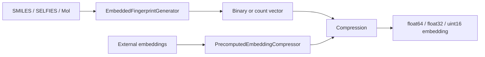

# FPembed - Generalized Molecular Fingerprint Embeddings

[](https://badge.fury.io/py/fpembed)
[](https://doi.org/10.5281/zenodo.21447996)
[](https://fpembed.readthedocs.io/en/latest/?utm_source=github&utm_medium=repository&utm_campaign=readme)

## Contents

- [Introduction](#introduction)
- [Why Embedded Fingerprints](#why-embedded-fingerprints)
- [Install](#install)
- [Quick Start](#quick-start)
- [Fingerprint Types at a Glance](#fingerprint-types-at-a-glance)
- [Quickstart Notebook](#quickstart-notebook)
- [Original Concept (eMFP)](#original-concept-emfp)
- [License](#license)
- [Legal & Trademark Notice](#legal--trademark-notice)
- [Commercial & Research Services](#commercial--research-services)
- [AI Disclosure](#ai-disclosure)
- [Support](#support)

## Introduction

FPembed turns standard molecular fingerprints into compact, dense vectors for machine learning. It
accepts SMILES, SELFIES, and RDKit Mol input, supports fifteen fingerprint types, nine of which also
support count mode, and keeps the fingerprint, compression method, and output dtype explicit. It
returns a plain NumPy array, which fits a scikit-learn pipeline or any model that accepts a 2-D float
matrix.

The full technical reference is in the [documentation](https://fpembed.readthedocs.io/en/latest/?utm_source=github&utm_medium=repository&utm_campaign=readme).



## Why Embedded Fingerprints

Compression reduces a fingerprint of length L to an embedding of length D = L / C, where C is the
compression factor. At C=16, a 2048-bit fingerprint becomes 128 features, so downstream models see
about 16 times fewer inputs.

The guaranteed saving is the feature count and the stored byte count. Training speed, inference
speed, memory use, and sample efficiency often improve as a result. The size of that effect depends
on the model, hardware, and dataset.

FPembed makes the choice of fingerprint and compression method explicit. It offers six methods: four
block-wise schemes and two global projections. The default is `geometric` for binary input and
`uniform` for count input.

Three entry points cover the common paths: `EmbeddedFingerprintGenerator` for molecules,
`PrecomputedEmbeddingCompressor` for embeddings from another model, and `compress_fingerprint()` for
arrays you compress yourself.

## Install

### From source

```bash
git clone https://github.com/Sciencealone/fpembed.git
cd fpembed
python -m pip install -e .
```

### From PyPI

```bash
python -m pip install fpembed
```

Count fingerprints, fixed-width fingerprint types, and precomputed embeddings require FPembed 0.3.0
or newer. Use the source install if the PyPI release is older.

### Conda

```bash
conda create -n fpembed python=3.12
conda activate fpembed
python -m pip install fpembed
```

### Requirements

FPembed requires Python 3.10 or newer, below 3.14. Runtime dependencies are NumPy, RDKit,
scikit-fingerprints, and SELFIES.

## Quick Start

### Binary fingerprint

```python
from fpembed import EmbeddedFingerprintGenerator

gen = EmbeddedFingerprintGenerator(
    fp_type="ecfp",        # ECFP (Morgan) fingerprint
    fp_size=2048,          # fingerprint length
    compression=16,        # 2048 / 16 = 128 output features
    fp_params={"radius": 2},
)
embedding = gen.GetFingerprintFromSmiles("CCO")
print(embedding.shape)  # (128,)
```

### Count fingerprint

```python
# Count fingerprints use the same generator.
count_gen = EmbeddedFingerprintGenerator(
    fp_type="ecfp", fp_size=2048, compression=16,
    fp_params={"radius": 2},
    count=True, count_transform="log1p",
)
counts = count_gen.GetFingerprintFromSmiles("CCO")
print(counts.shape)  # (128,)
```

### Batch input and label alignment

```python
X, invalid = gen.GetFingerprintsFromSmiles(smiles)
y = [label for i, label in enumerate(labels) if i not in set(invalid)]
model.fit(X, y)
```

`X` is a 2-D float array, and the generator drops invalid SMILES, so filter labels with the same
indices. The iterator methods stream one molecule at a time, for inputs that do not fit in memory.

### Representation manifest

A JSON manifest describes every configuration.

```python
manifest = gen.representation_manifest()
```

## Fingerprint Types at a Glance

| Type | `fp_type` | Count mode | Native width |
|---|---|:---:|---:|
| Extended Connectivity (Morgan) | `ecfp` | Yes | `fp_size` |
| Atom Pair | `atom_pair` | Yes | `fp_size` |
| Topological Torsion | `topological_torsion` | Yes | `fp_size` |
| RDKit | `rdkit` | Yes | `fp_size` |
| Layered | `layered` | No | `fp_size` |
| Pattern | `pattern` | No | `fp_size` |
| Avalon | `avalon` | Yes | `fp_size` |
| SECFP | `secfp` | No | `fp_size` |
| MHFP | `mhfp` | Yes | `fp_size` |
| MAP4 | `map` | Yes | `fp_size` |
| Lingo | `lingo` | Yes | `fp_size` |
| Pharmacophore (folded) | `pharmacophore` | Yes | `fp_size` |
| PubChem | `pubchem` | No | 881, pad to 1024 |
| Laggner | `laggner` | No | 307, pad to 512 |
| ERG (bit) | `erg` | No | 315, pad to 512 |

Most types produce exactly `fp_size` values. PubChem and Laggner have a fixed native width and
require a padded `fp_size` that is a power of two and at least the native width. ERG's native width
depends on `max_path` and is padded the same way.

The [documentation](https://fpembed.readthedocs.io/en/latest/?utm_source=github&utm_medium=repository&utm_campaign=readme) lists every type parameter, default, count rule, and fixed-width padding cost
on its Fingerprint Types page.

## Quickstart Notebook

The quickstart notebook is at [examples/quickstart.ipynb](examples/quickstart.ipynb).

## Original Concept (eMFP)

The weighted binary masking approach was introduced for Morgan fingerprints in the eMFP paper:

> Nuñez-Andrade, E. A., Vidal-Daza, I., Gomez-Bombarelli, R., Ryan, J. W., and
> Martin-Martinez, F. J. (2025). Embedded Morgan Fingerprints for more efficient
> molecular property predictions with machine learning. ChemRxiv preprint.
> https://doi.org/10.26434/chemrxiv-2025-6hfp8

Original concept repository: [MMLabCodes/eMFP](https://github.com/MMLabCodes/eMFP)

## License

This project is licensed under the terms of the MIT open source license. See [LICENSE](LICENSE) for the full terms.

## Legal & Trademark Notice

The FPembed source code is licensed under MIT. That licence covers the code and does not include any right to use the FPembed name or logo.

"FPembed" is a trademark of the project author Mikhail Markovskii (@Sciencealone). A trademark application for the name has been filed.

Accurate references to FPembed are permitted: citing the project, stating that a tool uses or is compatible with FPembed, and redistributing an unmodified copy under its name. Uses that suggest the project endorses, sponsors, or operates a product or service need prior written permission from the trademark owner. Permission requests go to contact@fpembed.com.

## Commercial & Research Services

The project Maintainer provides project onboarding, corporate deployments, compute scaling on HPC,
Databricks, and Ray, and custom model fine-tuning for pharma R&D and research grants (Horizon Europe
/ Art. 60 LOSU / AEI). The Maintainer also provides technical support and handles related contract
work.

**[View Full Service Offerings & Contact Details](https://github.com/Sciencealone/FPembed/blob/main/COMMERCIAL_SUPPORT.md)**

## AI Disclosure

AI usage during project development is declared in [aidecl.yaml](aidecl.yaml) following the
[AI Declaration Format](https://ai-declaration.org/).

## Support

The Maintainer ships FPembed as-is and may update it over time. Open an issue if you have questions.
